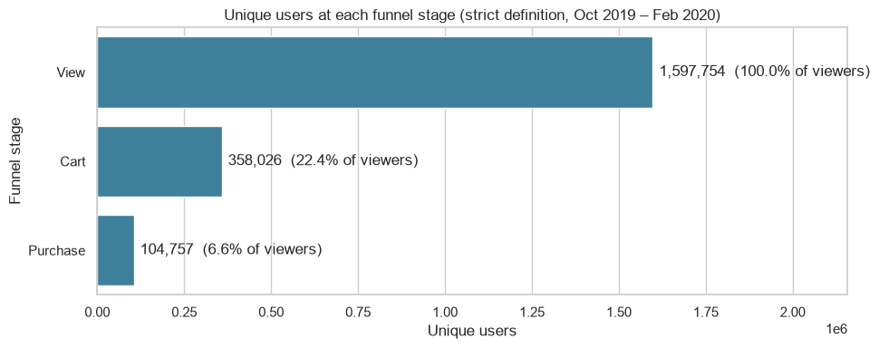
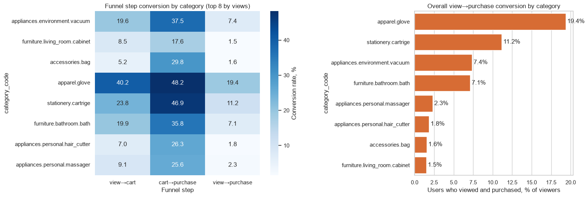
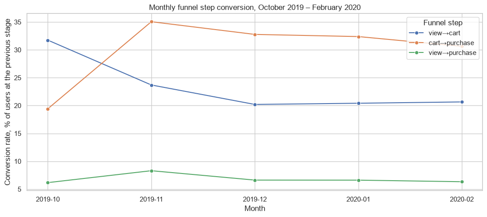
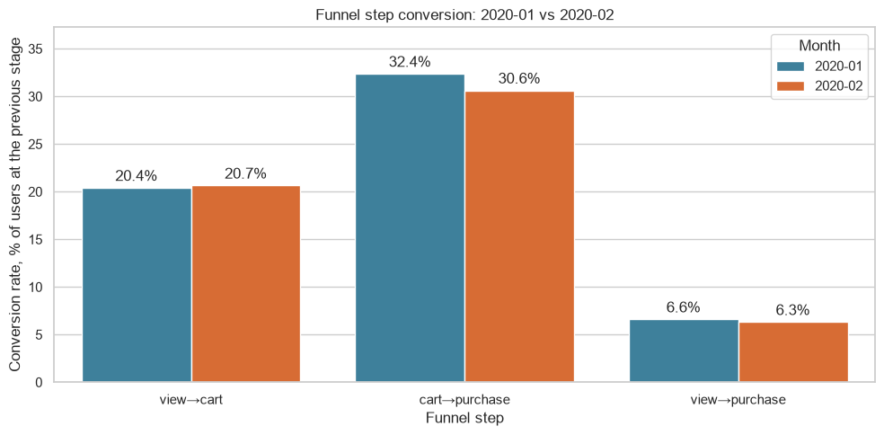
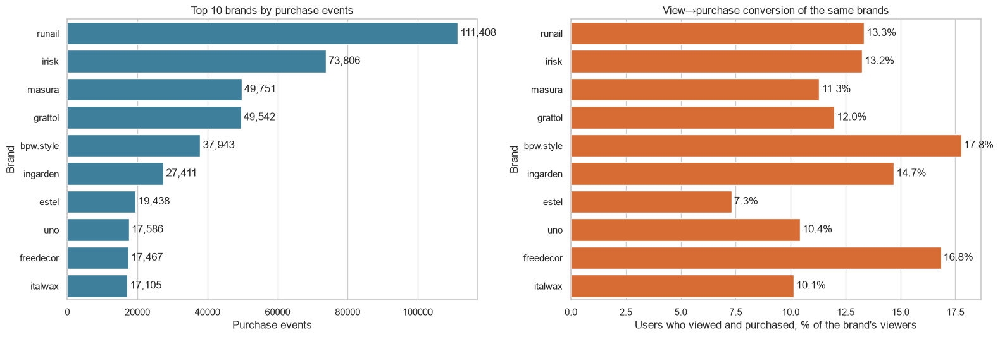
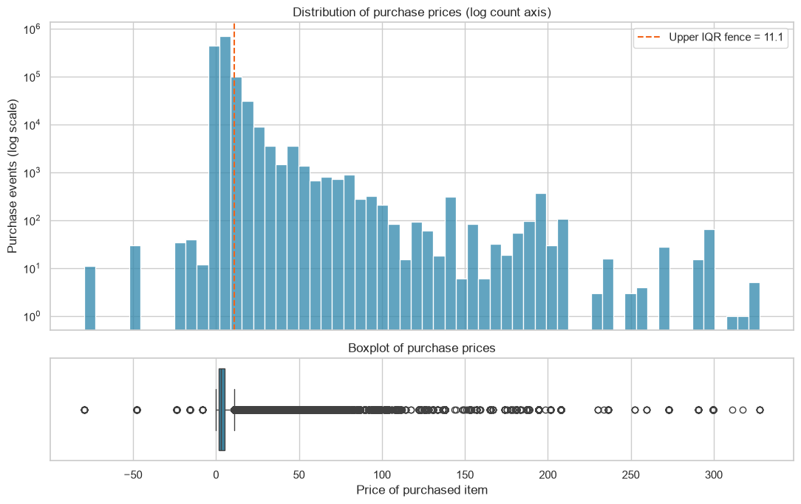
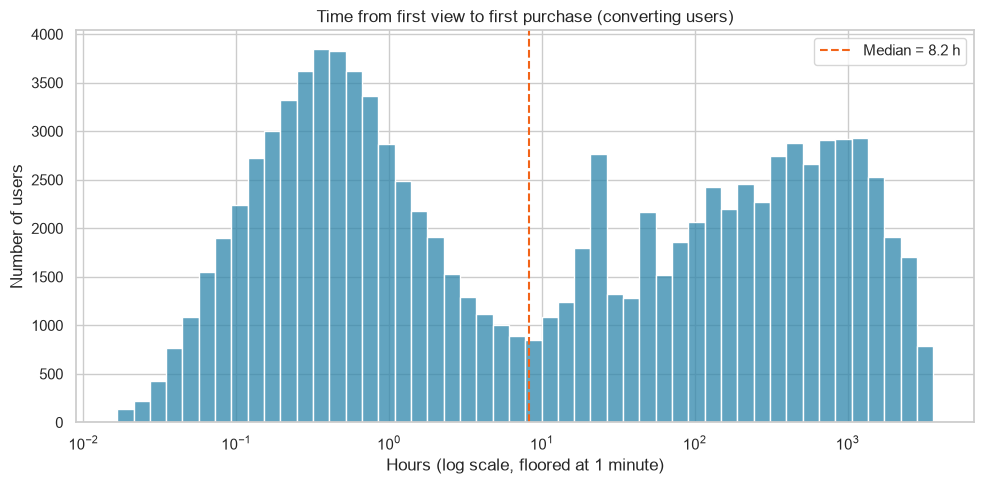
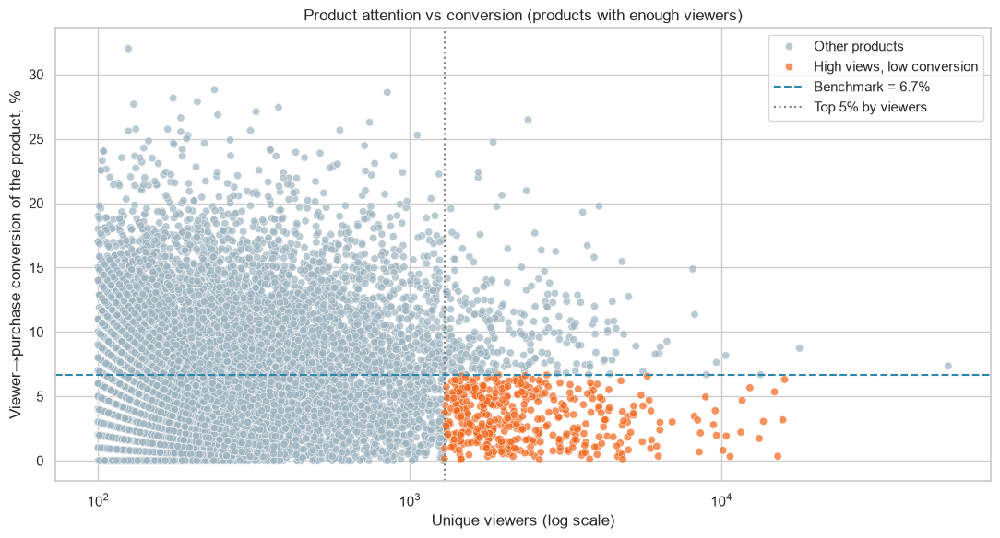

# Chart Guide: What Each Chart Shows and What It Means

This guide covers all eight charts produced by `Ecommerce_Funnel_Analysis_v2.ipynb`. Each section links to the PNG file and gives a short analysis: what the chart shows, the key numbers, what they mean, and what to be careful about.

All numbers come from the executed notebook (five monthly files, October 2019 to February 2020, 20,692,840 events). The funnel uses the **strict, user-level** definition unless stated otherwise: a user counts at a stage only if they also reached the previous stage. See [README NOTEBOOK](notebook/readme.md) for definitions and [README DATASET](dataset/readme.md) for the data.

## Index

| # | Chart | PNG file | Analysis |
|---|-------|----------|----------|
| 01 | Overall funnel | [01_overall_funnel.png](../charts/01_overall_funnel.png) | [Go to analysis](#chart-01-overall-funnel) |
| 02 | Conversion by category | [02_category_conversion.png](../charts/02_category_conversion.png) | [Go to analysis](#chart-02-conversion-by-category) |
| 03 | Monthly funnel trend | [03_monthly_funnel_trend.png](../charts/03_monthly_funnel_trend.png) | [Go to analysis](#chart-03-monthly-funnel-trend) |
| 04 | January vs February | [04_jan_vs_feb_conversion.png](../charts/04_jan_vs_feb_conversion.png) | [Go to analysis](#chart-04-january-vs-february) |
| 05 | Top 10 brands | [05_top_brands.png](../charts/05_top_brands.png) | [Go to analysis](#chart-05-top-10-brands) |
| 06 | Price outliers | [06_price_outliers.png](../charts/06_price_outliers.png) | [Go to analysis](#chart-06-price-outliers) |
| 07 | Time to purchase | [07_time_to_purchase.png](../charts/07_time_to_purchase.png) | [Go to analysis](#chart-07-time-to-purchase) |
| 08 | High-view, low-conversion products | [08_high_view_low_conversion_products.png](../charts/08_high_view_low_conversion_products.png) | [Go to analysis](#chart-08-high-view-low-conversion-products) |

---

## Chart 01: Overall funnel

[Open PNG](../charts/01_overall_funnel.png)

**What it shows.** Unique users at each funnel stage over the full five-month window.

**Key numbers.**

| Stage | Users | Share of viewers | Step rate |
|-------|------:|-----------------:|----------:|
| View | 1,597,754 | 100.0% | n/a |
| Cart | 358,026 | 22.4% | 22.4% of viewers |
| Purchase | 104,757 | 6.6% | 29.3% of carters |

**Analysis.**

- 77.6% of viewers (about 1.24 million users) never add anything to the cart, and 70.7% of carters never purchase. Both steps leak, but the view→cart step loses far more users in absolute terms.
- The loose definition (each stage counted independently) gives 24.9% view→cart, 27.7% cart→purchase and 6.9% overall. It differs from the strict result by at most 2.5 percentage points, so the conclusion does not depend on the definition.
- Only 911 purchasers (0.8%) have no cart event, and 5,312 (4.8%) have no view event. Skipping the cart is rare in this shop.
- Event-level ratios look very different (view→cart 59.7%, cart→purchase 22.3%, view→purchase 13.3%). The reason is that a few users generate many events: 5.77 million cart events come from roughly 400,000 users. Event ratios describe interactions, not people, and should not be compared with this chart.

**Careful.** The window is five months, so every user had five months to convert. Single-month funnels (charts 03 and 04) are lower for that reason.

---

## Chart 02: Conversion by category

[Open PNG](../charts/02_category_conversion.png)

**What it shows.** Left: step conversion (view→cart, cart→purchase, view→purchase) for the eight categories with the most view events. Right: overall view→purchase rate, ranked.

**Key numbers (view→purchase).**

| Category | Viewers | View→cart | Cart→purchase | View→purchase |
|----------|--------:|----------:|--------------:|--------------:|
| apparel.glove | 9,646 | 40.2% | 48.2% | 19.4% |
| stationery.cartrige | 10,124 | 23.8% | 46.9% | 11.2% |
| appliances.environment.vacuum | 33,987 | 19.6% | 37.5% | 7.4% |
| furniture.bathroom.bath | 8,049 | 19.9% | 35.8% | 7.1% |
| appliances.personal.massager | 1,335 | 9.1% | 25.6% | 2.3% |
| appliances.personal.hair_cutter | 2,379 | 7.0% | 26.3% | 1.8% |
| accessories.bag | 9,486 | 5.2% | 29.8% | 1.6% |
| furniture.living_room.cabinet | 13,378 | 8.5% | 17.6% | 1.5% |

**Analysis.**

- Conversion differs 13 times between the best category (apparel.glove, 19.4%) and the worst (furniture.living_room.cabinet, 1.5%).
- The categories separate for different reasons. `apparel.glove` is strong at both steps. `accessories.bag` has a normal cart→purchase rate (29.8%) but very few viewers add to the cart (5.2%), so its problem sits before the cart. `furniture.living_room.cabinet` is weak at both steps.
- Ranking by view→purchase and by cart→purchase gives a similar order (the top four and the bottom one are identical), so categories that convince carters also tend to convince browsers.

**Careful.** `category_code` is missing for 98.3% of all events and 97.6% of view events. This chart describes the small tagged subset only, and that subset is mostly non-cosmetic (appliances, furniture), so it is not representative of the shop. Differences may reflect price level or buyer intent, not page quality.

---

## Chart 03: Monthly funnel trend

[Open PNG](../charts/03_monthly_funnel_trend.png)

**What it shows.** The three funnel step rates, each computed inside its own calendar month.

**Key numbers.**

| Month | Viewers | View→cart | Cart→purchase | View→purchase |
|-------|--------:|----------:|--------------:|--------------:|
| 2019-10 | 388,331 | 31.7% | 19.4% | 6.16% |
| 2019-11 | 355,643 | 23.7% | 35.1% | 8.30% |
| 2019-12 | 358,212 | 20.2% | 32.8% | 6.62% |
| 2020-01 | 397,775 | 20.4% | 32.4% | 6.61% |
| 2020-02 | 379,246 | 20.7% | 30.6% | 6.33% |

**Analysis.**

- Overall conversion is flat from December to February (6.62%, 6.61%, 6.33%). The only large move is October to November (+2.14 percentage points, a +35% relative increase).
- October and November have opposite shapes. In October many viewers add to the cart (31.7%) but few of those carts convert (19.4%). In November fewer viewers add (23.7%) but far more carts convert (35.1%). Overall conversion rose because the second effect was larger than the first.
- Since December, view→cart has settled at about 20.2% to 20.7%, while cart→purchase has drifted down slowly (32.8% to 30.6%).
- November contains Black Friday week. A seasonal or promotional effect is a plausible explanation, but the data contains no campaign information, so it is untested.

**Careful.** The legend sits on top of the last cart→purchase point (30.6%); the value is shown in chart 04. Users active in several months appear in each month's funnel.

---

## Chart 04: January vs February

[Open PNG](../charts/04_jan_vs_feb_conversion.png)

**What it shows.** The three step rates for January and February 2020, the comparison the task asks for.

**Key numbers.**

| Step | Jan | Feb | Change | Cohen's h |
|------|----:|----:|-------:|----------:|
| View→cart | 20.41% | 20.65% | +0.24 pp | 0.01 |
| Cart→purchase | 32.38% | 30.63% | -1.75 pp | -0.04 |
| View→purchase | 6.61% | 6.33% | -0.28 pp | -0.01 |

**Analysis.**

- Overall conversion did **not improve**. It fell by 0.28 percentage points, a relative decline of 4.2%. The decline comes from the cart→purchase step; view→cart rose slightly.
- All three differences are statistically detectable (two-proportion z-tests, Bonferroni-adjusted alpha 0.0167), because each month has about 380,000 viewers. The effect sizes are negligible (|h| of 0.04 or less) and the relative change is small, so the practical meaning is limited.
- For context, the December to January change was -0.01 pp (p = 0.88, not significant). January to February is the third largest of the four month-over-month moves.

**Careful.** 15.8% of February viewers (60,034 users) also viewed in January, so the two samples are not independent and the p-values are somewhat optimistic. A difference over time is an association; it does not identify a cause.

---

## Chart 05: Top 10 brands

[Open PNG](../charts/05_top_brands.png)

**What it shows.** Left: the ten brands with the most purchase events. Right: the view→purchase rate of the same brands (users who viewed and purchased the brand, divided by users who viewed it).

**Key numbers.**

| Brand | Purchase events | Share of all purchases | Viewers | View→purchase |
|-------|----------------:|-----------------------:|--------:|--------------:|
| runail | 111,408 | 8.66% | 193,942 | 13.3% |
| irisk | 73,806 | 5.73% | 153,750 | 13.2% |
| masura | 49,751 | 3.87% | 81,397 | 11.3% |
| grattol | 49,542 | 3.85% | 106,093 | 12.0% |
| bpw.style | 37,943 | 2.95% | 42,573 | 17.8% |
| ingarden | 27,411 | 2.13% | 54,166 | 14.7% |
| estel | 19,438 | 1.51% | 92,359 | 7.3% |
| uno | 17,586 | 1.37% | 51,384 | 10.4% |
| freedecor | 17,467 | 1.36% | 24,692 | 16.8% |
| italwax | 17,105 | 1.33% | 45,764 | 10.1% |

**Analysis.**

- The top 5 brands account for 25.1% of all purchases and the top 10 for 32.7%. Runail alone is 8.7%. Sales are concentrated but not dominated by one brand.
- Volume and conversion do not line up. `estel` has the fourth-largest audience of the ten (92,359 viewers) but the lowest conversion (7.3%). `bpw.style` (17.8%) and `freedecor` (16.8%) convert best but reach far fewer viewers (42,573 and 24,692).
- Purchase count is not revenue. Revenue per purchase event ranges from 1.18 (`bpw.style`) and 1.30 (`freedecor`) to 10.84 (`uno`) in the price units of the file. `grattol` has about the same number of purchases as `masura` but nearly twice the revenue (266,296 vs 139,765).

**Careful.** 42.7% of purchases have no brand, so these shares describe the known-brand part only: the top 5 are 43.7% of branded purchases. Whether more visibility would keep a high conversion rate at larger scale is untested.

---

## Chart 06: Price outliers

[Open PNG](../charts/06_price_outliers.png)

**What it shows.** Top: histogram of purchase prices on a logarithmic count axis, with the upper IQR fence. Bottom: the same prices as a boxplot.

**Key numbers.**

| Measure | Value |
|---------|------:|
| Purchase events with price | 1,287,007 |
| Q1 / median / Q3 | 1.59 / 3.00 / 5.40 |
| IQR fences (lower / upper) | -4.13 / 11.12 |
| Outliers | 90,657 (7.04% of purchases) |
| Share of revenue from outliers | 34.9% |
| Mean vs median price | 4.93 vs 3.00 |
| Maximum price | 327.78 |

**Analysis.**

- 7% of purchases are IQR outliers, and they carry 34.9% of revenue. The price distribution is strongly right-skewed (mean 4.93 against median 3.00), so averages overstate the typical purchase.
- The highest-priced rows are repeated purchases of the same products at the same price: product 5906221 sold at 327.78 five times in the top ten, across December to February, and product 89343 at 299.81 three times. Repeated identical prices over months point to genuine premium items, not data-entry errors, so the outliers were kept.
- At basket level (155,617 purchasing sessions), the mean basket is 40.79 against a median of 29.21, and 6.0% of baskets exceed the IQR fence of 99.62. The largest basket is 1,738.10.

**Careful.** The histogram also shows a few purchases with **negative** prices (down to roughly -80). Across all event types 104,288 rows (0.5%) have a price of zero or below. They are kept in the analysis and should be investigated before the price figures are used for revenue reporting.

---

## Chart 07: Time to purchase

[Open PNG](../charts/07_time_to_purchase.png)

**What it shows.** For users who converted, the time from their first view to their first purchase, on a logarithmic hour axis (floored at one minute). The dashed line is the median.

**Key numbers (user level, 102,237 converting users).**

| Measure | Value |
|---------|------:|
| Median | 8.2 hours |
| Mean | 285.9 hours |
| 25th / 75th percentile | 0.4 h / 263.8 h |
| 90th percentile | 1,030.9 h (about 43 days) |
| Purchased within 1 hour | 36.8% |
| Purchased within 24 hours | 56.2% |

For the narrower user-and-product definition (first view of a product to first purchase of the same product, 450,507 pairs) the median is 1.25 hours and 71.6% purchase within 24 hours.

**Analysis.**

- The distribution has **two clusters**. One peaks at roughly 20 to 30 minutes (same-session buyers). A second, broader group buys days to weeks later, with a small spike near 24 hours (next-day returns).
- The median (8.2 hours) falls in the valley between the two clusters, so it describes neither group. The mean (285.9 hours) is pulled up by the late group. Reporting a single "average time to purchase" would hide the real pattern.
- Decision timing therefore needs two separate tactics: in-session nudges for the fast group and reminders or remarketing over days and weeks for the slow group.

**Careful.** 2,969 of 105,206 converting users (2.8%) were excluded because their first purchase came before any observed view. The right edge of the chart (about 150 days) is limited by the length of the data window, so very late purchases cannot appear.

---

## Chart 08: High-view, low-conversion products

[Open PNG](../charts/08_high_view_low_conversion_products.png)

**What it shows.** Each dot is a product with at least 100 unique viewers (13,731 products). The x-axis is the number of unique viewers (log scale), the y-axis is the share of those viewers who later bought the product. Orange dots are products in the top 5% by viewers (at least 1,288) that convert below the store-wide benchmark of 6.7%.

**Key numbers.**

| Measure | Value |
|---------|------:|
| Products with views | 53,854 |
| Eligible products (at least 100 viewers) | 13,731 |
| Benchmark product conversion | 6.66% |
| Flagged products | 418 (3.0% of eligible) |
| Share of all product views taken by flagged products | 17.8% |
| Purchases they would add at benchmark conversion | about 41,335 |

The largest single gaps (viewers, conversion, missed purchases at benchmark): product 5877456 (15,150, 0.34%, 957), product 5808664 (10,660, 0.33%, 675), product 5856186 (13,215, 1.73%, 652), product 5769877 (10,110, 0.80%, 592) and product 5877454 (15,716, 3.18%, 548).

**Analysis.**

- A small group of 418 products attracts 17.8% of all product views and converts well below average. This is the largest concentrated lost-demand pool in the data.
- The top flagged products differ in price. Product 5877456 has a median price of 122.22 and converts at 0.34%, which suggests a price barrier. Product 5808664 costs only 6.37 and converts at 0.33%, so price is not the explanation there; stock, images or reviews are more likely. These are hypotheses to test, not findings.
- The 41,335 purchases are an upper bound (every flagged product reaching the average). Treat it as a way to rank effort, not as a forecast.

**Careful.** Low conversion can also reflect browsing intent, such as price comparison. The data has no stock, review or page-content information to separate these causes. `category_code` is unknown for all of the top ten flagged products.

